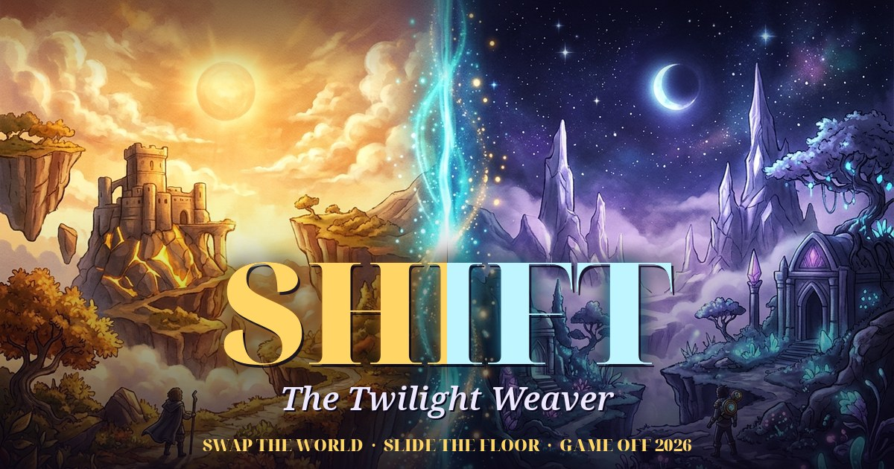

# SHIFT: The Twilight Weaver

<p align="center">
  
</p>

A handcrafted puzzle-platformer created for **[GitHub Game Off 2026](https://itch.io/jam/game-off-2026)** (Theme: **SHIFT**).

> **Author & Creator:** [github.com/rachmatsumo](https://github.com/rachmatsumo)  
> **Repository:** [github.com/rachmatsumo/shift-game](https://github.com/rachmatsumo)  
> **Category:** 2D Puzzle-Platformer / Web Game  
> **License:** MIT  

---

## 📖 Deskripsi Permainan (Game Description)

**SHIFT: The Twilight Weaver** adalah sebuah permainan *puzzle-platformer* 2D atmosferik yang mengeksplorasi tema **SHIFT** melalui dualitas realitas, gravitasi, dan sudut pandang.

Pemain mengendalikan **Sang Penenun Senja** (*The Twilight Weaver*), sosok pengembara bertudung dengan selendang sutra bercahaya yang melintasi 50 level teka-teki misterius. Di dunia ini, realitas terbelah menjadi dua dimensi yang beririsan: **Siang (*Day Realm*)** dan **Malam (*Night Realm*)**. Rintangan duri mematikan di siang hari dapat berubah menjadi jembatan kristal yang aman di malam hari, dan jurang tak berdasar dapat diseberangi berkat gravitasi rendah yang meringankan bobot langkah sang penenun.

### ✨ Fitur Unggulan
1. **Mekanik Reality Shift**: Tekan `SHIFT` (atau tombol sentuh di HP) untuk menukar dimensi secara instan—membalik rintangan, membuka lorong rahasia, dan memindahkan balok runic.
2. **Dualitas Fisika & Gravitasi**:
   - **Siang (Day Realm):** Gravitasi normal, langkah mantap dan cepat untuk melewati platform dinamis.
   - **Malam (Night Realm):** Gravitasi rendah (*low gravity*), lompatan melayang tinggi, dan perlambatan waktu yang anggun.
3. **Balok Runic Geser (Movable Tracks)**: Rel platform ungu interaktif yang bergeser posisi setiap kali dimensi ditukar, menuntut strategi dan ketepatan timing.
4. **50 Level Buatan Tangan & Pecahan Shard**: Kumpulkan seluruh pecahan kristal bercahaya (*Shards*) di setiap level untuk membuka Gerbang Runic menuju dimensi berikutnya.
5. **Kejaran Boss Kolosal (Chase Sequences)**: Hadapi kejaran menegangkan dari *Void Shadow Colossus* dan *Astral Leviathan* yang menuntut transisi dimensi cepat tanpa henti.
6. **Komik Naratif & Filosofis (5 Babak)**: Ilustrasi visual berkualitas tinggi yang menceritakan asal-usul perpecahan semesta dan makna mendalam dari "menggeser sudut pandang".
7. **Papan Skor & Kustomisasi Gamer**: Hall of fame lokal dengan penyimpanan skor persisten (`localStorage`), pemilihan avatar, dan bendera negara.
8. **Pengalaman Mobile & PWA Modern**: Responsif di smartphone mode landscape, kontrol jempol virtual yang ergonomis, gesture swipe untuk navigasi halaman & swipe back bawaan perangkat.

---

## 🌟 Filosofi & Konsep ("What does it mean to SHIFT?")

*Terkadang, solusi dari kebuntuan bukanlah memaksa maju, melainkan menggeser sudut pandang dan membiarkan diri melayang sejenak.*

1. **Shift of Reality (Pergeseran Realitas & Sudut Pandang):**  
   Tembok buntu atau bahaya mematikan di satu dimensi hanyalah ilusi ketiadaan di dimensi lainnya. Saat kita menghadapi jalan buntu dalam hidup, kita tidak perlu memaksakan diri—kita hanya perlu menggeser cara pandang (*shift perspective*).
2. **Shift of Gravity & Time (Dualitas Beban Kehidupan):**  
   - **Siang:** Mewakili aksi, keduniawian, gravitasi yang berat, dan langkah cepat.  
   - **Malam:** Mewakili introspeksi, kelegaan tanpa bobot (*low gravity*), dan perlambatan waktu.  
   Keduanya saling melengkapi; kita membutuhkan gravitasi siang untuk melangkah maju, dan membutuhkan kelegaan malam untuk melompat lebih tinggi.
3. **The Shift Key (Integrasi Antarmuka):**  
   Tombol keyboard yang biasanya hanya digunakan untuk membesarkan huruf kini menjadi tuas pembelah semesta: satu klik kecil untuk lompatan realitas yang besar.

---

## 🎮 Kontrol Permainan

### Desktop Keyboard
- `A` / `D` atau `◀` / `▶` : Bergerak ke Kiri / Kanan
- `SPACE` / `W` / `▲` : Melompat (*Jump*)
- `SHIFT` atau `E` / `K` : **SHIFT** (Tukar Dunia / Geser Rel Blok Ungu)
- `P` atau `ESC` : Jeda Permainan (*Pause*)
- `R` : Mengulang level secara cepat (*Quick Restart*)
- `X` : Keluar ke Layar Utama (*Quit to Main Menu* - saat Pause)
- `L` : Buka Layar Pilih Level (*Level Select*)
- `H` : Buka Kisah & Komik Filosofi (*Lore*)
- `B` : Buka Papan Skor (*Leaderboard*)
- `T` : Ganti Bahasa (Indonesia / English)
- `F` : Mode Layar Penuh (*Fullscreen Toggle*)
- `M` : Mengaktifkan / Mematikan Audio (*Mute Toggle*)

### Mobile & Touch Devices (PWA Ready)
- **Otomatis Adaptif:** Kontrol sentuh otomatis muncul pada perangkat HP/tablet dan tetap bersih/tersembunyi saat dimainkan di PC dengan keyboard.
- **Jempol Kiri:** D-Pad navigasi horizontal (`◀` / `▶`).
- **Jempol Kanan:** Tombol aksi bercahaya untuk `JUMP` dan `SHIFT`.
- **Navigasi Gestur Sentuh:**
  - **Swipe Horisontal (Level Select):** Geser layar ke kiri atau kanan untuk berganti halaman level (*Next / Prev Page*).
  - **Swipe Back:** Usap tepi kiri layar ke kanan atau gunakan tombol Back ponsel untuk kembali ke menu sebelumnya tanpa keluar dari aplikasi.
  - **Bar Navigasi Atas:** Akses cepat satu ketukan untuk Main Menu (`🏠`), Restart (`↺`), Fullscreen (`⛶`), dan Suara (`🔊`).

---

## 🏆 Leaderboard System (`src/leaderboard.js`)

Papan peringkat (*Leaderboard / Hall of Fame*) berjalan secara lokal di browser menggunakan modul [src/leaderboard.js](file:///var/www/html/shift-game/src/leaderboard.js):
- **Pencatatan Persisten:** Menyimpan nama pemain, avatar pilihan, negara, level tertinggi, catatan waktu tercepat (*time*), jumlah kematian (*deaths*), dan perolehan bintang (*stars*) di `localStorage`.
- **Skor Awal:** Dilengkapi entri awal untuk langsung menyajikan antarmuka papan skor yang hidup sejak pertama kali dimainkan.
- **Akses Instan:** Tekan tombol `B` pada keyboard di menu utama atau tap menu *"Papan Skor / Leaderboard"*.

---

## 🛠 Tech Stack
- **Zero External Dependencies:** 100% Vanilla ES6 JavaScript + Canvas 2D API (`1920x1080` resolusi dasar dengan penyesuaian skala dinamis).
- **Procedural Synthesizer Audio Engine:** Sintesis polifonik berbasis Web Audio API tanpa file audio MP3/WAV eksternal (progresi akor Lydian/Dorian, arpeggio senja, dan denyut ketegangan boss).
- **PWA & Offline Capable:** Service Worker caching (`sw.js`), web app manifest (`manifest.json`), dan overlay orientasi landscape.
- **Headless BFS Solver:** Built-in verification suite (`node tools/verify-levels.js`) yang memverifikasi seluruh 50 level 100% dapat diselesaikan (*solvable*).

---

## 📦 Panduan Gitignore & Kebersihan Rilis (Release Workflow)

Repositori ini telah dikonfigurasi dengan berkas [.gitignore](file:///var/www/html/shift-game/.gitignore) untuk memastikan lingkungan rilis yang bersih dan siap pakai (*clean release*).

### Berkas yang Diabaikan (.gitignore):
- **Arsip & Build Output:** `*.zip`, `*.tar.gz`, `dist/`, `build/` (mencegah penumpukan file rilis binary di git history).
- **File Sistem Operasi:** `.DS_Store`, `Thumbs.db`, `Desktop.ini`.
- **Pengaturan Editor/IDE:** `.vscode/`, `.idea/`, `*.swp`.
- **Dependensi & Log Sementara:** `node_modules/`, `*.log`, `tmp/`.

### Berkas Produksi (Tracked Files):
```
├── index.html              # Entry point utama web game
├── manifest.json           # Konfigurasi PWA & metadata aplikasi
├── sw.js                   # Service worker untuk mode offline
├── assets/                 # Aset visual (komik, background, thumbnail, icon)
│   ├── og-image.jpg        # Open Graph Image & Banner Utama (1200x630)
│   ├── itch-cover.jpg      # Cover Thumbnail untuk Itch.io (630x500)
│   ├── comic_1..5.jpg      # Panel cerita & filosofi seni
│   ├── icon-192 / 512.png  # Ikon PWA
│   └── favicon.svg         # Favicon browser
├── src/                    # Seluruh logika permainan (Vanilla ES6)
│   ├── game.js             # Engine platformer, render loop, touch controls
│   ├── levels.js           # 50 handcrafted level maps & boss data
│   ├── audio.js            # Procedural Web Audio synthesizer
│   ├── profile.js          # Pengaturan profil gamer & kustomisasi
│   ├── leaderboard.js      # Hall of fame & penyimpanan skor
│   └── i18n.js             # Sistem bilingual (Indonesia / English)
└── tools/                  # Script pembantu verifikasi solver level
```

### Verifikasi Kebersihan Sebelum Rilis:
Sebelum melakukan commit atau rilis versi baru ke GitHub, jalankan:
```bash
# 1. Pastikan seluruh level terverifikasi solvable
node tools/verify-levels.js 1 2 5 10 50

# 2. Periksa status repositori bersih dari file sampah
git status
```
